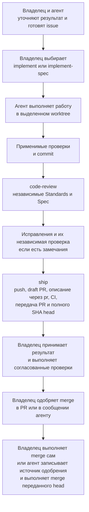
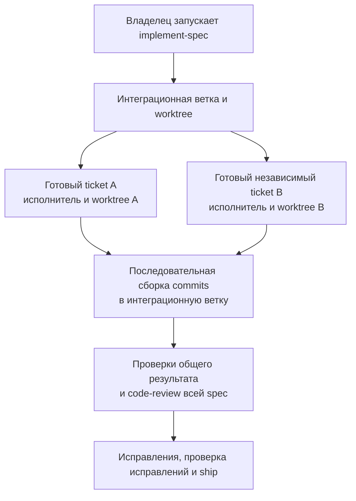
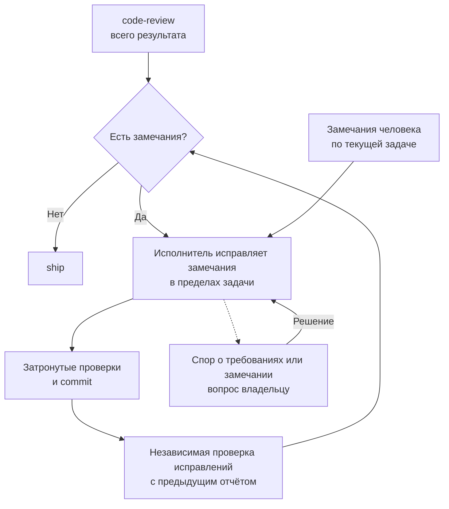

# Как проходит работа с агентом

Карта для владельца и команды. Она показывает порядок работы и ведёт к правилам.
Правила записаны в [AGENTS.md](../AGENTS.md), [docs/agents/](agents/) и skills. Карта не добавляет агенту полномочий.

Issue — задача в GitHub. Spec — описание согласованного изменения со сценариями и критериями.
Worktree — отдельная рабочая копия репозитория со своей веткой. CI — автоматические проверки в GitHub.

## Общий путь

SHA — идентификатор конкретного commit. Приёмка результата и разрешение merge — отдельные решения.
При передаче агент называет полный SHA последнего commit в PR. Агент выполняет merge только этого commit и только после явного разрешения владельца.
Любой новый commit, включая обновление из main, требует нового разрешения. Подробности: [правила доставки](agents/delivery.md#main-and-owner-acceptance).

## С чего начать

| Ситуация | Подготовка | Запуск реализации |
| --- | --- | --- |
| Понятная небольшая задача | Короткая issue: результат, границы, критерии и проверки | Владелец выбирает `implement` |
| Новая идея с открытыми вопросами | Обсуждение; при необходимости исследование или прототип | После согласования конкретного изменения |
| Большое изменение | Владелец выбирает `to-spec`, затем при необходимости `to-tickets` | `implement-spec` для spec с tickets либо отдельный `implement` для ticket |
| Баг с неизвестной причиной | `diagnosing-bugs` собирает воспроизводимый сигнал и проверяет причины | Диагностика сама по себе не разрешает исправление |

Назвать выбранный skill можно обычной фразой: «Выполни issue через implement».
Просьба без выбора входа приводит к предложению маршрута. Агент ждёт выбора владельца.
Выбор между короткой issue и spec описан в [правилах работы с требованиями](agents/requirements.md).

## Маленькая задача и большая spec

`implement` ведёт одну согласованную задачу. `implement-spec` ведёт граф tickets в интеграционной ветке.
Ticket — отдельная задача, связанная со spec. Граф показывает, какие tickets зависят друг от друга.
Готовые независимые tickets выполняют параллельные исполнители в своих worktree.
Координатор последовательно собирает их commits в интеграционную ветку.

Worktree разделяет файлы, а стек Compose остаётся общим. Правила общей среды: [worktrees.md](agents/worktrees.md#shared-resources).

## Кто исправляет замечания

`code-review` возвращает два независимых отчёта. Reviewers только сообщают замечания.
В `implement` исправления делает основной агент, в `implement-spec` их делает один свежий исполнитель.
Исправления проверяет независимый reviewer с предыдущим отчётом.

Порядок ревью, исправлений и остановки описан в [правилах доставки](agents/delivery.md#review-and-corrections).
Standards использует [CODING_STANDARDS.md](../CODING_STANDARDS.md). Файл пополняется после реальных пропусков ревью.
Механически проверяемые требования переходят в инструменты.

## Что делает ship и что делает pr

| Участник | Действие | Результат |
| --- | --- | --- |
| `ship` | Отправляет ветку и создаёт либо обновляет draft PR | Один PR для текущей поставки |
| `pr` | Формирует описание: изменение, доказательства, ограничения и действия человека | Текст PR по [правилам отчёта](agents/pr.md) |
| CI | Выполняет обязательные проверки текущего результата | Успешный `ci-ok` либо конкретная ошибка |
| `ship` | Сверяет актуальность ревью, проверок и человеческих решений до передачи | PR готов к приёмке владельцем |

## Где участвует человек

В начале владелец выбирает нужное поведение, границы и вход реализации.
Дополнительные проверки согласуются в issue или spec. Новые существенные вопросы агент показывает по мере обнаружения.
Каждый итоговый PR принимает владелец. Когда нужна дополнительная проверка и как её описать: [human-review.md](agents/human-review.md).

## Где описано поведение

Spec отвечает на вопрос «что тогда попросили и почему». После merge её не переписывают.
Текущее поведение показывают тесты, термины хранит `GLOSSARY.md`, существенные решения хранят ADR.
Источники для каждого вопроса: [requirements.md](agents/requirements.md#current-behavior-and-history).
Skills Matt совпадают с закреплённой версией, кроме строк, которые отсылают к правилам проекта. Список отличий: [.agents/skills/README.md](../.agents/skills/README.md).
План оценки процесса после первых задач: [#46](https://github.com/KirillSachkov/ai-first-platform/issues/46).
