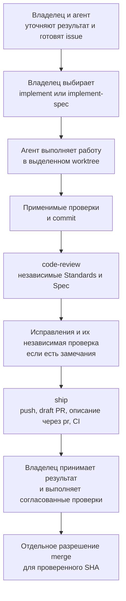
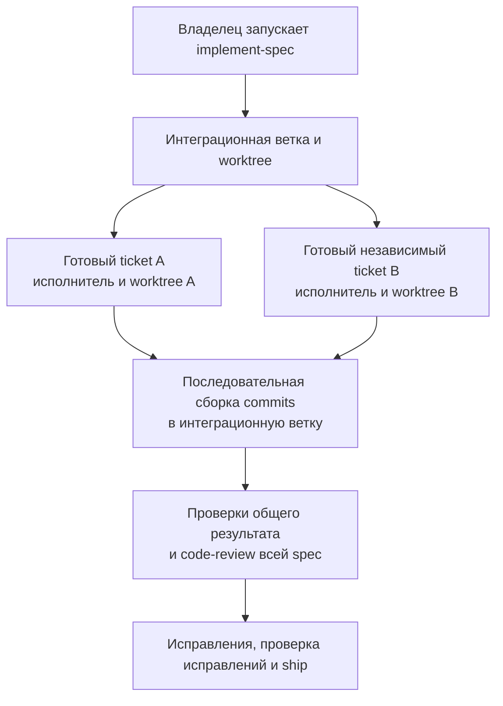
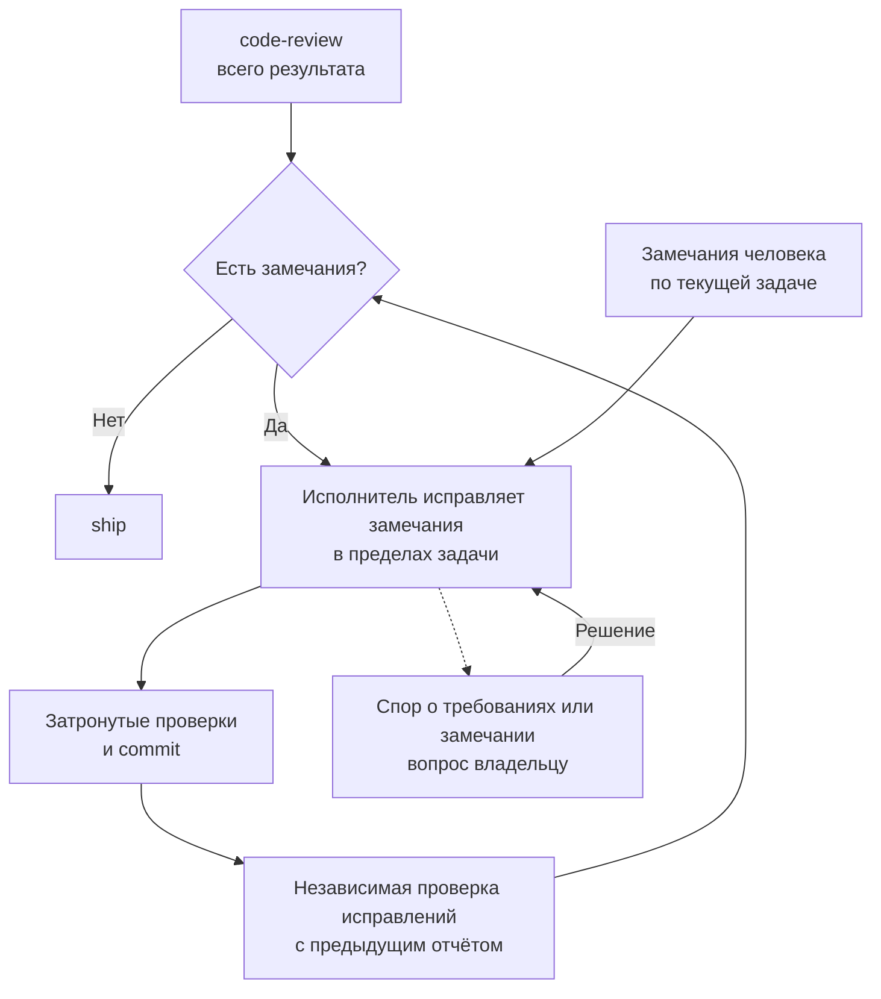

# Как проходит работа с агентом

Карта для владельца и команды. Она объясняет действующий порядок работы в этом репозитории.
Источники правил: [AGENTS.md](../AGENTS.md), skills и тематические [инструкции доставки](agents/delivery.md).
Карта помогает читать эти источники и не добавляет новых полномочий агенту.

Issue — задача в GitHub. Spec — описание согласованного изменения со сценариями и критериями.
Worktree — отдельная рабочая копия репозитория со своей веткой. CI — автоматические проверки в GitHub.

## Общий путь

SHA — идентификатор конкретного commit. Приёмка результата и разрешение merge — отдельные решения.
Агент может выполнить разрешённый merge с проверкой SHA. После нового commit требуется новое разрешение.

## С чего начать

| Ситуация | Подготовка | Запуск реализации |
| --- | --- | --- |
| Понятная небольшая задача | Короткая issue: результат, границы, критерии и проверки | Владелец выбирает `implement` |
| Новая идея с открытыми вопросами | Обсуждение; при необходимости исследование или прототип | После согласования конкретного изменения |
| Большое изменение | Владелец выбирает `to-spec`, затем при необходимости `to-tickets` | `implement-spec` для spec с tickets либо отдельный `implement` для ticket |
| Баг с неизвестной причиной | `diagnosing-bugs` собирает воспроизводимый сигнал и проверяет причины | Диагностика сама по себе не разрешает исправление |
| Быстрое небольшое исправление | Короткая issue; полная spec обычно не нужна | Тот же `implement`, worktree и применимые проверки |

Назвать выбранный skill можно обычной фразой: «Выполни issue через implement».
Просьба без выбора входа приводит к предложению маршрута. Агент ждёт выбора владельца.
Полная spec нужна по сложности поведения, а не для каждой правки документации или бага.
Подробности подготовки находятся в [правилах работы с требованиями](agents/requirements.md).

При отдельной диагностике агент сохраняет доказательства и удаляет свои временные диагностические вставки.
Он передаёт причину или оставшуюся неопределённость и следующий шаг.
Если уже запущена реализация, агент может применять диагностику внутри согласованной задачи.

## Маленькая задача и большая spec

`implement` ведёт одну согласованную задачу. Агент готовит worktree, выполняет изменение и получает независимое ревью.
Для поведения и багов он применяет `tdd` по правилам проекта.
Документация и настройки проходят подходящие проверки без искусственных бизнес-тестов.
Проверки и исключения определены в [testing.md](agents/testing.md).

Ticket — отдельная задача, связанная со spec.
`implement-spec` ведёт граф tickets в интеграционной ветке и worktree.
Граф показывает, какие tickets зависят друг от друга.
Готовые независимые tickets могут выполнять параллельные исполнители в своих worktree.
Координатор последовательно собирает их commits в интеграционную ветку.
Исполнители используют `tdd`; они не запускают user-only `implement` для каждого ticket.
После сборки `code-review` проверяет общий результат spec.

Spec получает draft PR после первого интегрированного результата.
Один итоговый PR может закрыть spec и несколько tickets.
Интегрированный ticket может открыть зависимую работу, пока общая поставка ещё не слита.
Worktree разделяет файлы. Compose остаётся общим; [правила общей среды](agents/worktrees.md#shared-resources) действуют для всех исполнителей.

## Кто исправляет замечания

`code-review` возвращает два независимых отчёта. Reviewers сообщают замечания и остаются читателями.
В `implement` исправления делает основной агент.
В `implement-spec` один свежий implementer исправляет замечания общего ревью.
Исполнитель запускает затронутые проверки, делает commit и получает независимую проверку исправлений.
Reviewer получает предыдущий отчёт, проверяет исправления и затронутые взаимодействия.
Полный анализ повторяется, если меняются требования или более широкие взаимодействия.

Отдельного этапа подтверждения каждой находки автором нет.
Спорное замечание агент сохраняет с объяснением и показывает владельцу.
Предложение нового поведения требует согласования и не расширяет задачу автоматически.
Пока существенное решение отсутствует, зависимая работа ждёт; независимая согласованная работа может продолжаться.
Если повторные исправления не дают результата, агент обращается к владельцу по [правилам доставки](agents/delivery.md#verification-evidence).

Замечания человека обрабатываются в рамках активного поручения.
Комментарий к другой задаче сам по себе не запускает реализацию.
Без замечаний работа сразу переходит к `ship`.
Незакрытое блокирующее замечание останавливает доставку.
Предыдущие отчёты сохраняют покрытие всего результата, даже если последний reviewer проверял только исправления.

Standards использует [CODING_STANDARDS.md](../CODING_STANDARDS.md) для контекстной проверки.
Файл содержит проектные ограничения и ссылки на их основания.
После реальных пропусков ревью он пополняется знаниями: когда проверять, что искать и почему это важно.
Механически проверяемые требования переходят в инструменты.

## Что делает ship и что делает pr

| Участник | Действие | Результат |
| --- | --- | --- |
| `ship` | Отправляет ветку и создаёт либо обновляет draft PR | Один PR для текущей поставки |
| `pr` | Формирует понятное описание: изменение, доказательства, ограничения и действия человека | Текст PR с подходящим Markdown |
| CI | Выполняет обязательные проверки текущего результата | Успешный `ci-ok` либо конкретная ошибка |
| `ship` | Сверяет актуальность ревью, проверок и человеческих решений до передачи | PR готов к приёмке владельцем |

Для маленькой задачи draft PR создаётся после локальных проверок и независимого ревью.
Spec использует уже созданный draft PR.
Если CI падает, агент исправляет проблему в пределах поручения.
Исправления получают затронутые проверки, commit и независимую проверку перед повторной передачей PR.
Затем агент обновляет тот же PR и снова ждёт CI.
Спор о требованиях или чужая поломка передаются владельцу по [правилам доставки](agents/delivery.md).

## Где участвует человек

В начале владелец выбирает нужное поведение, границы и вход реализации.
Известные дополнительные проверки согласуются в issue или spec.
Новые существенные вопросы агент показывает по мере обнаружения.
Перед передачей Spec reviewer сверяет требования, весь diff и доказательства.

Дополнительная проверка нужна для важных изменений прав, данных, бизнес-правил, пользовательских сценариев, CI и полномочий агента.
Недостаточные доказательства тоже требуют внимания. Вопрос должен объяснять последствие ошибки и ожидаемый результат.
Человек может оценить существующее доказательство вместо повторного прогона всех тестов.
В PR агент прямо объясняет:

- Что изменилось и чем опасна ошибка.
- Что уже подтверждают автоматические проверки и независимое ревью.
- Кто должен выполнить оставшуюся проверку и что именно сделать.
- Какой результат ожидается и когда он нужен для продолжения работы.

Точный порядок выбора и описания проверки находится в [human-review.md](agents/human-review.md).

Каждый итоговый PR принимает владелец. Если дополнительных ручных проверок нет, агент кратко объясняет это.
Зелёный CI и агентское ревью не являются разрешением merge.
Владелец либо уполномоченный им агент выполняет merge по [правилам для конкретного SHA](agents/delivery.md#main-and-owner-acceptance).
После merge связанные issues закрываются согласно условиям поставки. Deployment в этот маршрут не входит.

## Где описано поведение

Spec отвечает на вопрос «что тогда попросили и почему». После merge её не переписывают.
Отдельного документа с текущим поведением нет. Текущее поведение показывают тесты.
Термины хранит `DOMAIN.md`. Существенные решения хранят ADR.
Новая issue ссылается на прежнюю и называет заменённый критерий.
Источники для каждого вопроса перечислены в [requirements.md](agents/requirements.md#current-behavior-and-history).

## Что изменено относительно закреплённых skills Matt

Сравнение относится к [версии a496f55](https://github.com/mattpocock/skills/tree/a496f5513d4a4cf889bc48e189e579f4b0bdf6aa/skills/engineering), указанной в происхождении набора.
Оно не описывает будущие версии upstream.

| Вопрос | Закреплённая версия Matt | Наш текущий проект |
| --- | --- | --- |
| Вход `implement` | Работа из spec или tickets; переданная ссылка на ticket загружается условно | Issue обязательна по правилам проекта, которые skill читает через AGENTS |
| Worktree | У `implement-spec` исполнители получают отдельные worktree | Отдельная копия нужна каждой самостоятельной реализации |
| Проверки | Общие указания TDD, typechecking и test suite | Применимые уровни из testing.md |
| Порядок малого `implement` | Вызов review перед финальным commit | Commit перед review закреплённого результата |
| Доставка | Малый `implement` заканчивает commit; `implement-spec` имеет условную работу с PR | Оба пути вызывают проектный `ship` и ждут CI |
| Замечания | Большой путь поручает исправления одному свежему исполнителю; повторное ревью не предписано | Малый путь исправляет основной агент, большой — свежий исполнитель; исправления проверяет независимый reviewer |

Основания: закреплённые [implement](https://github.com/mattpocock/skills/blob/a496f5513d4a4cf889bc48e189e579f4b0bdf6aa/skills/engineering/implement/SKILL.md) и [implement-spec](https://github.com/mattpocock/skills/blob/a496f5513d4a4cf889bc48e189e579f4b0bdf6aa/skills/engineering/implement-spec/SKILL.md),
наши [implement](../.agents/skills/implement/SKILL.md) и [implement-spec](../.agents/skills/implement-spec/SKILL.md).
Выбор обязательной issue и особой доставки принадлежит этому проекту.
`implement` читает условия подготовки и доставки через проектные pointers в AGENTS.
В этом проекте они требуют issue, выделенный worktree и `ship`; другой проект может определить свои условия.

## Первое применение и доработка процесса

Решение от 3 ноября 2026 года: начинаем разработку с текущим harness.
Статические проверки и независимое ревью не выявили препятствий для начала работы.
Применение процесса на реальной продуктовой задаче ещё не проверено.

Следующий шаг — обычная задача проекта. После двух-трёх задач вернёмся к оценке процесса.
Для разбора сохраним критерии задачи, commits, версию skills, отчёты ревью, исправления и результаты проверок.
Также учтём лишние изменения, обращения к владельцу, число проходов и доступные данные о времени и затратах.

Для будущего сравнения оставлены польза независимой проверки исправлений, предел числа проходов, ошибочные замечания и возобновление работы после передачи PR.
Можно сравнить текущий процесс с вариантом без обязательного повторного ревью на одинаковых исходных задачах.
Проверку результата проведёт независимый оценщик. Такой эксперимент пока не выполнен.
Первые задачи дадут наблюдения, но не докажут превосходство одного подхода.

Сейчас новые этапы, численный предел проходов и отдельный механизм разрешения споров не добавлены.
Необязательные предложения из ревью [PR #34](https://github.com/KirillSachkov/ai-first-platform/pull/34) остаются кандидатами для будущей проверки.
Действующие условия остановки и обращения к владельцу сохраняются.
